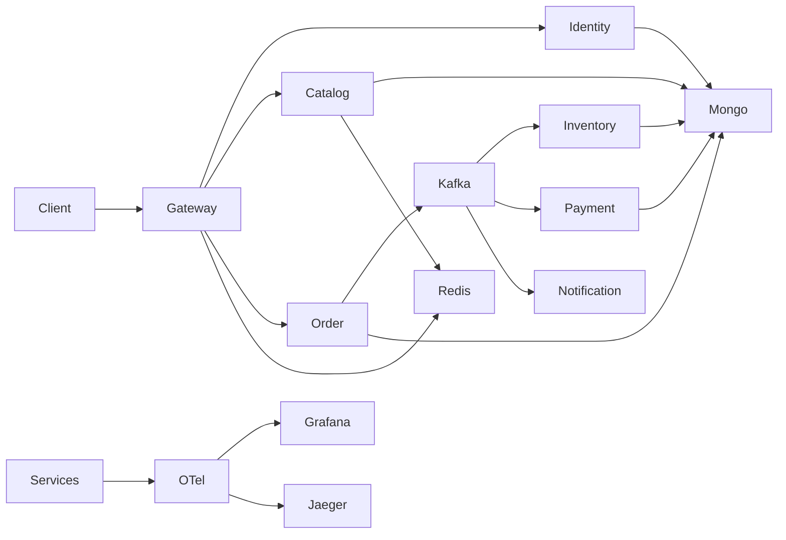

# Commerce Flow

Production-oriented event-driven ecommerce platform built with Node.js, TypeScript, MongoDB, Kafka, and Redis.

The project demonstrates microservice boundaries, saga orchestration, a transactional outbox, idempotent consumers, and the operational controls around them. The workspace, local infrastructure, shared clients, identity, catalog, inventory, orders, and payments are in place. The gateway verifies access tokens, rate-limits login, and proxies the public API. Notification is still ahead.

## Status

| Area                                                 | Status                                                                    |
| ---------------------------------------------------- | ------------------------------------------------------------------------- |
| pnpm workspace, TypeScript, ESLint, Prettier, Vitest | In place                                                                  |
| Shared MongoDB, Redis, and Kafka clients             | In place                                                                  |
| RS256 access-token verification                      | In place. Identity signs tokens and checks them on `GET /users/me`.       |
| Identity                                             | Registration, login, refresh rotation, logout, and audit records.         |
| NestJS + Fastify service skeletons                   | In place. Startup opens each service's clients and readiness pings them.  |
| Docker image build and GitHub Actions                | In place. Pull requests run checks, and `main` publishes images.          |
| MongoDB, Kafka, Redis, observability stack           | Local Compose stack                                                       |
| Catalog, inventory, orders, payments                 | In place                                                                  |
| Notification                                         | Later                                                                     |
| Order saga retry and dead letter                     | In place. Attempt state is stored on the order.                           |
| Transactional outbox and consumer inbox              | In place for inventory, orders, and payments.                             |
| OpenTelemetry traces and metrics                     | In place. Logs stay on Pino and include `traceId` when a span is active.  |
| Gateway authentication and proxy                     | In place. Login is rate-limited. Payment HTTP is not on the public edge.  |
| Contract tests and the order-flow suite              | In place. `pnpm test:e2e` needs Docker and ports 3000–3005.               |
| Service images                                       | In place. `docker compose --profile full up` runs them with the stack.    |
| Kubernetes manifests                                 | In place. `make k8s-up` installs kind and starts a local cluster.         |
| Event catalog, saga notes, OpenAPI, and ADRs         | In place. The public API is `docs/openapi.yaml`.                          |
| Storefront                                           | In place. Next.js app on port 3010 for signup, catalog, cart, and orders. |

## Architecture



Six services own their data. The gateway is the public edge. Services do not read each other's databases. Client APIs are REST. Business workflows move through Kafka. The order service orchestrates the saga with inventory and payment commands.

## Services

| Service              | Port | Database        |
| -------------------- | ---- | --------------- |
| api-gateway          | 3000 | none            |
| identity-service     | 3001 | identity-db     |
| catalog-service      | 3002 | catalog-db      |
| inventory-service    | 3003 | inventory-db    |
| order-service        | 3004 | order-db        |
| payment-service      | 3005 | payment-db      |
| notification-service | 3006 | notification-db |

Each service exposes:

- `GET /health/liveness` — process is alive
- `GET /health/readiness` — `200` when the process and its required clients respond, `503` when a required client is down. Unit tests call `createApp()` and stay process-only. `bootstrap()` opens the clients.

`GET /metrics` returns Prometheus text. When `OTEL_EXPORTER_OTLP_ENDPOINT` is set, traces and metrics are also exported to that collector. Without it, the process still serves `/metrics` after `bootstrap()`. Unit tests that only call `createApp()` report that telemetry is not started.

The gateway on port 3000 is the public API. Register, login, and refresh are open and limited to 10 requests per IP each minute. Every other `/api/v1` route requires an access token and the matching permission. The gateway proxies identity, catalog, inventory, and orders, and it sets a customer's `customerId` from the token subject. It forwards the bearer token to identity so `GET /users/me` can verify it, and it sends `x-user-id` to the other upstreams instead of the raw token. Order idempotency stays in `order-db`; the gateway forwards `Idempotency-Key`. Payment HTTP is not proxied. `CORS_ORIGINS` lists allowed browser origins. `docs/security/threat-model.md` describes what this does not close.

## Repository

```text
apps/        independently deployable NestJS services
packages/    cross-cutting technical contracts and helpers
tests/       event contract checks and the Docker order-flow suite
infra/       container build
docs/        architecture notes
.github/     CI, security, and image-build workflows
```

Shared packages stay framework-agnostic. NestJS modules are not shared, so a service can be deployed without pulling another service's HTTP stack into a library.

| Package       | Boundary                                                                                                            |
| ------------- | ------------------------------------------------------------------------------------------------------------------- |
| config        | Typed startup configuration. Missing values fail the process.                                                       |
| errors        | Public error envelope. Unknown failures do not leak driver or stack details.                                        |
| contracts     | `/api/v1`, correlation headers, idempotency header, health paths.                                                   |
| logger        | Pino JSON logs with credential redaction.                                                                           |
| auth          | Roles, permissions, claim shape, and RS256 verification. Identity owns signing and the role grants.                 |
| events        | Versioned event envelope, event names, and topic routing.                                                           |
| kafka         | Aggregate partition keys, the order retry / DLQ decision, and a producer client.                                    |
| mongodb       | Database-per-service names, replica-set check, index plan, and a driver client.                                     |
| redis         | Cache and idempotency key shape, a client, and cache-aside. Refuses to store orders, payments, inventory, or users. |
| observability | Health reports, dependency startup, OpenTelemetry traces and metrics, and Prometheus `/metrics`.                    |
| test-utils    | Environment builder for tests.                                                                                      |

## Quick start

Requirements: Node.js 22 or newer (CI and Docker use Node.js 24), pnpm 12.6.0.

pnpm 12 ships an ESM entrypoint. The Corepack bundled with Node.js 22.14 cannot launch it. Upgrade Corepack first if `corepack pnpm --version` fails:

```bash
npm install -g corepack@latest
corepack enable
corepack prepare pnpm@12.6.0 --activate
pnpm install
pnpm lint
pnpm typecheck
pnpm test
pnpm build
```

`pnpm test` runs the unit tests, the event contract checks, and the storefront tests. `pnpm test:e2e` (`make test-e2e`) needs a Docker daemon. It starts MongoDB 8, Redis 8, and Confluent Kafka 7.7, then boots identity, catalog, inventory, order, payment, and the gateway on ports 3000–3005. Stop `make dev` first so those ports are free. Compose uses Apache Kafka 4.1.2; the end-to-end broker is the Confluent image the Testcontainers module starts. A declined payment finishes as `failed` with saga `COMPENSATION_COMPLETED`, and the reserved stock is restored. That path does not publish `order.cancelled`. When `DOCKER_HOST` is unset and `~/.colima/default/docker.sock` exists, the suite uses that socket. Pull requests run the same checks on GitHub-hosted runners. Details are in [docs/architecture/ci.md](docs/architecture/ci.md).

`pnpm --filter @commerce-flow/storefront dev` starts the shop on port 3010. The server calls the gateway at `GATEWAY_URL`, which defaults to `http://127.0.0.1:3000`. Signup, login, the catalog, the cart, checkout, and order status go through that API. Checkout places an order, and the order service asks payment to authorize it. The shop does not collect card numbers.

Start the local stack, create the empty databases and topics, create a local JWT key pair, then run the services on the host:

```bash
make infra-up
make seed
make jwt-keys
make dev
```

`make jwt-keys` writes `secrets/jwt-private.pem` and `secrets/jwt-public.pem` when those files are absent. They are gitignored. Identity refuses to start without them.

`make infra-up` waits until MongoDB has a primary, Redis answers `PING`, Kafka accepts connections, and the UI endpoints respond. `make seed` does not insert business data. `make reset` wipes the service databases, Redis, and catalog topics, then seeds them again. `make infra-down` stops the containers and keeps their volumes.

Copy `.env.example` when you start one service by hand. The MongoDB URI must use `127.0.0.1`, which is the replica set member host. Details are in [docs/architecture/local-infrastructure.md](docs/architecture/local-infrastructure.md).

`make lint`, `make typecheck`, `make test`, `make test-e2e`, and `make build` run the same checks as the pnpm scripts.

Service images, including the infrastructure they wait for. Run `make jwt-keys` once so identity and the gateway can mount `secrets/jwt-*.pem`. Stop `make dev` first; the containers publish ports 3000–3006.

```bash
make jwt-keys
docker compose --profile full up -d --build
```

`make apps-up` is the same Compose command. `docker compose up -d` still starts only MongoDB, Kafka, Redis, and the observability stack, and `make dev` runs the Node processes on the host. Inside Compose the gateway calls `identity-service`, `catalog-service`, `inventory-service`, and `order-service` by DNS name. On the host those upstreams stay on `127.0.0.1` and the service ports. Container health checks call `GET /health/readiness`.

`make k8s-up` installs `kind` and `kubectl` when they are missing, stops the Compose containers, and applies `infra/kubernetes/overlays/dev`. The cluster reuses the local images. JWT keys are a Secret created from `secrets/` at apply time. Port-forward the gateway with `kubectl -n commerce-flow port-forward svc/api-gateway 3100:3000`. Port-forward Prometheus with `kubectl -n commerce-flow port-forward svc/prometheus 9090:9090`. Port-forward Grafana with `kubectl -n commerce-flow port-forward svc/grafana 3007:3000` and open `http://127.0.0.1:3007/d/commerce-kafka-flow`. `make k8s-down` deletes that cluster. Details are in [docs/architecture/kubernetes.md](docs/architecture/kubernetes.md).

## Decisions already fixed

- **TypeScript 6.0.3.** TypeScript 7 is published, and `typescript-eslint` 8.70 still declares support only through 6.0.x. The toolchain stays on 6.0.3 until the linter range moves.
- **Node.js 24 in CI and Docker, Node.js 22+ for local engines.** Node.js 24 is the current Active LTS. The engine range still allows the Node.js 22 maintenance line.
- **ESM.** NestJS 12 and Zod 4 publish ESM. Packages and services set `"type": "module"`.
- **One configuration object, per-service database check.** Every process loads the same `AppConfig` shape. A service that owns data must set `MONGO_DATABASE` to its own database. The gateway does not get a pass to read another service's database; it does not open MongoDB.
- **Retry policy for the order workflow.** Transient failures use local delays of 100ms, 500ms, and 2s, then `commerce.orders.retry.1m`, `commerce.orders.retry.5m`, and `commerce.orders.retry.30m`, then `commerce.orders.dlq`. Each delay grows by up to 20 percent. Validation and authentication failures stop the ladder and stay on the order. A version conflict is tried again on the next sweep and does not advance the ladder. The attempt counters, the next time, and a short redacted error are stored on the order. A process restart resumes from that time. Short delays also arm an in-process timer. The delayed topics are published for visibility and consumed so their offsets commit. A message that arrives before `nextAttemptAt` is ignored. Dead-lettering leaves the saga in its current state and sets `dlqPublished`, so a reserved order is not released by this step. `POST /api/v1/orders/:id/retries` with `If-Match` clears the ladder and keeps `retryCount`. The gateway allows that route for the admin role. The order port still accepts it when `x-user-id` is absent.
- **Event payloads are not invented ahead of their producers.** The envelope and event names are fixed. Payload schemas are added with the service that publishes the event.
- **Role grants live in the identity service.** `customer` can read products and create, read, and cancel orders. `support` can read products, orders, and inventory, and cancel orders. `admin` receives every user permission. `service` has none. Self-registration always stores `customer`.
- **Public errors are generic for unknown failures.** `AppError` messages are intentional client text. Mongo errors, stacks, tokens, and connection strings are not copied into HTTP bodies. Configuration errors name the field and do not echo the value. Driver failures become `DEPENDENCY_UNAVAILABLE` and the logged text has URL userinfo removed.
- **Clients.** `mongodb`, `redis`, and `kafkajs` are the drivers the architecture already selected. `jose` signs and verifies RS256 tokens. `@node-rs/argon2` hashes passwords. OpenTelemetry exports traces and metrics. Identity creates its user, refresh-token, and audit indexes at startup. Catalog creates product and category indexes at startup. Inventory creates stock and reservation indexes at startup. Order creates order and idempotency indexes at startup. Payment creates payment indexes at startup.
- **Catalog reads.** Prices are integer minor units plus a 3-letter currency. New products are `draft`. Product and category changes require `If-Match` and bump `version`. Redis cache-aside uses a 60 second TTL and the writer deletes product and list keys in the same process. Catalog does not publish `ProductUpdated`. Category routes exist so a product can reference a real category. The catalog port does not require a token. The gateway requires `products:write` for changes and `products:read` for reads.
- **Inventory holds.** Available stock moves to `reserved` with one conditional update, then a reservation row is inserted in the same MongoDB transaction. The same order and SKU reserve again without decrementing twice. Holds last 15 minutes. A sweep marks them expired and returns the quantity. A commit command finalizes a hold: `reserved` decreases and `available` stays down, so expiration no longer returns that quantity. Inventory does not install the reservation TTL index, because that would delete the row without returning stock. The reserve, release, and failure events are inserted into `outbox_events` in that same transaction. A dispatcher publishes them to Kafka.
- **Orders.** The client sends the product name and unit price. The order stores those snapshots and does not read the catalog. Money is an integer in minor units. Discount, tax, and shipping are zero until a pricing policy exists. Saga state lives on the order document, and every change goes through one transition table. The gateway writes `customerId` from the token subject for a customer. A call to the order port without `x-user-id` still uses the body. Idempotency keys are stored in `order-db` for 24 hours. Redis is not opened by this service. Creating an order inserts the order, the idempotency key, and the `order.created` plus reserve commands in one transaction. Later steps append their commands in the same transaction as the saga update. A failed outbox insert still follows the retry ladder. A reserved order moves to `PAYMENT_PENDING`. Authorization confirms the order and commits the stock hold. A decline releases the hold. Cancel and a dead-letter replay require `If-Match`. The gateway requires a token. The order port stays open on the private network.
- **Payments.** The provider is an in-process mock. It does not call Stripe and it does not store card numbers, expiry, or CVV. A request that includes those fields is rejected. `PAYMENT_FAILURE_MODE` is `authorize` or `decline` for the process, and one authorization can override it with `simulate`. The same order and amount replays the stored result. A refund is allowed only after authorization. The authorization or decline is stored with its outbox row in one transaction.
- **Transactional outbox and inbox.** Inventory, orders, and payments append `outbox_events` inside the MongoDB transaction that changes their own data. A one-second dispatcher publishes pending rows and marks them published after Kafka accepts them. A crash after the broker accepts the record and before the mark publishes the same `eventId` again. Consumers insert `inbox_events` in the same transaction as the business write, with a unique `(eventId, consumer)` index, and skip a message that was already recorded. The order retry topics are wake-ups and are not stored in the inbox, because an early message would otherwise suppress the later one. The sweep still runs from `nextAttemptAt`. Kafka downtime is retried by the dispatcher, capped at 30 seconds, and is not dead-lettered. The saga ladder still runs when recording the outbox row fails.
- **Dependency profile.** The gateway opens Redis. Identity opens MongoDB. Catalog opens MongoDB and Redis. Inventory, orders, payments, and notifications open MongoDB and Kafka. A service does not open a client it has no current use for.
- **Gateway upstreams.** Host processes use `http://127.0.0.1` plus the service port. Compose and the Kubernetes namespace set `GATEWAY_IDENTITY_URL`, `GATEWAY_CATALOG_URL`, `GATEWAY_INVENTORY_URL`, and `GATEWAY_ORDER_URL` to the service DNS names, because a container's loopback is not the other services. Payment HTTP stays off the gateway in both layouts.
- **OpenTelemetry.** Traces use the HTTP, MongoDB, KafkaJS, and Redis instrumentations. Metrics use the names in the architecture notes, including order, saga, inventory, payment, cache, and MongoDB command latency. Kafka consumer lag is the offset lag reported at the end of a fetch batch. `GET /metrics` is the Prometheus scrape. `OTEL_EXPORTER_OTLP_ENDPOINT` also sends traces to `/v1/traces` and metrics to `/v1/metrics`. Shutdown flushes telemetry before the Kafka, Redis, and MongoDB clients close. Logs stay on Pino and add `traceId` and `x-correlation-id` on completed HTTP requests.
- **Identity tokens.** Access tokens last 15 minutes and refresh tokens last 7 days. Passwords are Argon2id (19 MiB, 2 iterations). Refresh tokens are 256-bit random values stored as SHA-256 so they can be looked up. Presenting a rotated refresh token revokes that token family. Logout revokes the presented refresh token and does not treat a repeated logout as reuse.

## Local infrastructure choices

- **One MongoDB node.** It is initiated as replica set `rs0`, which is enough for local transactions. Three data nodes would not change the application contract.
- **Plaintext Kafka and open Redis.** Host and container listeners are split so both `make dev` and Compose can connect. Authentication is a deployment concern, not part of this local stack.
- **Seed is structural.** It creates databases and topics only. Products and users are created through their APIs.

## Documentation

- [Architecture](docs/architecture/system-context.md)
- [Local setup](docs/architecture/local-infrastructure.md) and [configuration](.env.example)
- [Public API](docs/openapi.yaml), with examples in the service sections below
- [Event catalog](docs/events.md)
- [Saga design and failure scenarios](docs/architecture/saga.md)
- [Observability](docs/architecture/system-context.md) and [CI](docs/architecture/ci.md)
- [Security](docs/security/threat-model.md)
- [Testing](docs/architecture/ci.md) via `pnpm test` and `pnpm test:e2e`
- [Deployment](docs/architecture/kubernetes.md)
- [Storefront](apps/storefront) on port 3010
- [ADR index](docs/adr/README.md)

## What comes next

The implementation phases through documentation are in place. Direct service ports stay open on the private network.

## Inventory API

The inventory service listens on port 3003. The gateway proxies these routes and requires `inventory:read` or `inventory:write`. The service port stays open on the private network. Stock is not read from the catalog.

```http
POST /api/v1/inventory
GET  /api/v1/inventory/:sku
POST /api/v1/inventory/:sku/adjustments
POST /api/v1/inventory/reservations
GET  /api/v1/inventory/reservations/:id
POST /api/v1/inventory/reservations/:id/release
```

Create stock with `{ "sku", "quantity" }`. `quantity` is the available count. Adjustments send a non-zero integer delta. Reserve with `{ "orderId", "sku", "quantity" }`. A new reservation is `201`. The same order, SKU, and quantity again is `200` and does not take more stock. Not enough stock, an inactive SKU, or a conflicting quantity is `409`. An unknown SKU is `404`. Those failures also publish `inventory.reservation.failed`. Release and expiration publish `inventory.released`.

Kafka commands on `commerce.inventory.commands.v1` use the same reserve and release behavior. Invalid commands are skipped. A dependency failure leaves the offset uncommitted so the broker redelivers. `GET /health/readiness` pings the producer. It does not prove the consumer group has joined.

## Order API

The order service listens on port 3004. The gateway proxies these routes and sets `customerId` from the token subject for a customer. The service port accepts the body value when `x-user-id` is absent.

```http
POST /api/v1/orders
GET  /api/v1/orders?customerId=
GET  /api/v1/orders/:id
POST /api/v1/orders/:id/cancel
POST /api/v1/orders/:id/retries
```

Create with `Idempotency-Key` and `{ "customerId", "currency", "items": [{ "productId", "sku", "name", "unitPrice", "quantity" }] }`. `unitPrice` is an integer in minor units. A new order is `201`. The same key and body is `200` and returns the original order. The same key with a different body is `409`. List requires `customerId`. GET and POST responses set `ETag` to the version. Cancel and retry require `If-Match`; a missing header is `428` and a stale version is `409`. Retry returns `200`. A completed, compensation-completed, or failed saga is `409`.

A created order stays `pending` with saga state `INVENTORY_RESERVATION_PENDING` until every line is reserved. It then requests payment. Authorization moves the order to `confirmed` and publishes `order.confirmed`. The service also asks inventory to commit the hold so the 15-minute reservation sweep does not return that stock. A decline, or an inventory failure, finishes as `failed` and does not publish `order.cancelled`. If the caller cancels while payment is still in flight and authorization arrives later, the service requests a refund and releases the hold. A caller cancel that finishes publishes `order.cancelled`.

If Kafka is down after the order is stored, the saga records `nextAttemptAt` and retries at 100ms, 500ms, and 2s, then after 1, 5, and 30 minutes. A seventh failure publishes `saga.dead-lettered` on `commerce.orders.dlq` and stops the sweep. The order stays in its current saga state. `POST /api/v1/orders/:id/retries` starts the ladder again.

## Payment API

The payment service listens on port 3005. The gateway does not proxy these routes. Send an amount and a currency. Do not send card data.

```http
POST /api/v1/payments/authorizations
GET  /api/v1/payments/:id
POST /api/v1/payments/:id/refunds
```

Authorize with `{ "orderId", "amount", "currency" }`. `amount` is an integer in minor units. An optional `simulate` of `authorize` or `decline` overrides `PAYMENT_FAILURE_MODE` for that call. A new payment is `201`. The same order and amount again is `200`. A different amount for that order is `409`. A declined payment cannot be refunded. Kafka commands on `commerce.payment.commands.v1` use the same rules. The order service is the normal caller. It does not send `simulate`.

## Catalog API

The catalog service listens on port 3002. The gateway proxies reads with `products:read` and writes with `products:write`. The service port stays open on the private network.

```http
POST   /api/v1/categories
GET    /api/v1/categories
GET    /api/v1/categories/:id
PATCH  /api/v1/categories/:id
DELETE /api/v1/categories/:id
POST   /api/v1/products
GET    /api/v1/products
GET    /api/v1/products/:id
PATCH  /api/v1/products/:id
DELETE /api/v1/products/:id
```

Create a category before a product. A product body is `{ "name", "categoryId", "variants": [{ "sku", "name", "price": { "amount", "currency" } }] }`. `slug`, `description`, and `status` are optional. Status defaults to `draft`. `amount` is an integer in minor units. List products with `page`, `limit` (max 100), `status`, `categoryId`, `q`, `sort` (`createdAt` or `name`), and `order`. GET, POST, and PATCH responses set `ETag` to the version. PATCH and DELETE require `If-Match`; a missing header is `428 PRECONDITION_REQUIRED` and a stale version is `409 CONFLICT`. Deleting a category that still has products is `409`. Redis failures are logged and do not fail a committed MongoDB write.

## Identity API

The identity service listens on port 3001. The gateway proxies these routes. Register, login, and refresh are public and rate-limited. Logout and the current user require an access token.

```http
POST /api/v1/users/register
POST /api/v1/users/login
POST /api/v1/users/refresh
POST /api/v1/users/logout
GET  /api/v1/users/me
```

Register and login accept `{ "email", "password" }` and return a bearer access token, a refresh token, and the user id, email, and roles. `GET /api/v1/users/me` sends `Authorization: Bearer`. Passwords must be 12 to 128 characters. A duplicate email is `409 CONFLICT`. A bad login is `401` for both an unknown email and a wrong password.
